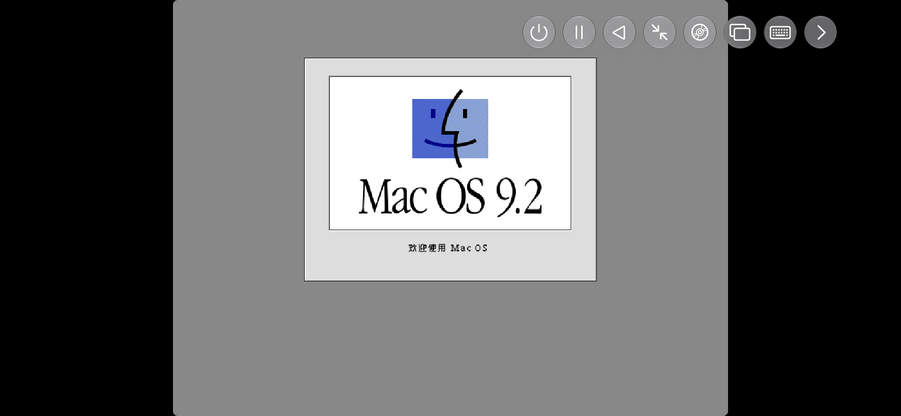
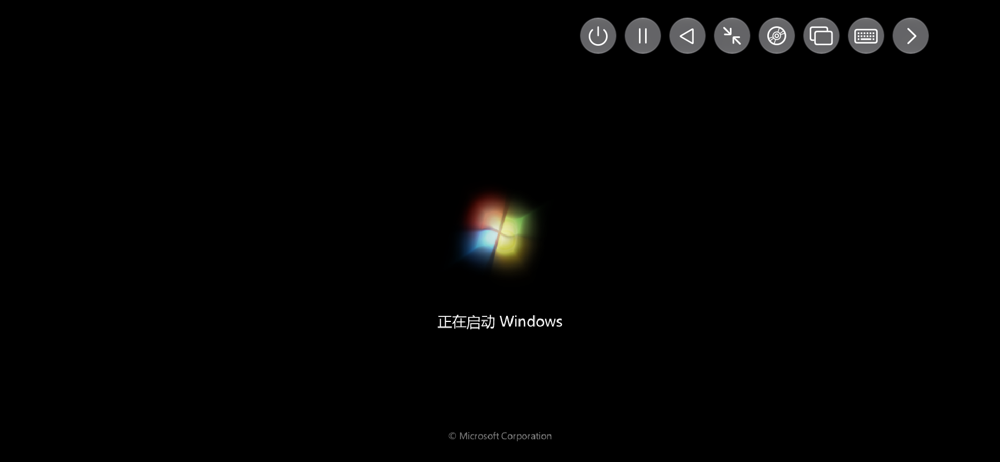

  

[PC on iPhone](https://maihaobo.github.io/PC-on-iPhone-Website/)（下载、系统画廊、安装与使用教程、常见问题）

# PC on iPhone

PC on iPhone 作为 UTM 的优化版，是专为 iOS 打造的虚拟机（VM）与系统模拟器。它基于 QEMU，让你在 iPhone 和 iPad 上运行 Windows、Linux 等桌面系统。

  
  

---

## 特色

- 基于 QEMU 的全系统模拟（MMU、设备等）
- 支持 30+ 处理器架构，包括 x86_64、ARM64 和 RISC-V
- 图形模式：SPICE 与 QXL VGA
- 文本终端模式
- USB 设备直通
- 基于 QEMU TCG 的 JIT 加速
- 采用最新 API，为 iOS 11+ 从头设计的前端
- 直接在设备上新建、管理、移除虚拟机
- 支持在设备上管理应用缓存与虚拟机缓存

## 关于 SE 版本

PC on iPhone/QEMU 需要动态代码生成（JIT）才能获得最佳性能。iOS 上的 JIT 通常需要越狱设备，或依赖针对特定 iOS 版本的变通方案；非 SE 版需借助配置工具开启 JIT 后方可使用。

**SE（Slow Edition，较慢版）** 改用线程解释器，性能优于传统解释器，但仍慢于 JIT。该思路与 [iSH](https://github.com/ish-app/ish) 用于动态执行的方案类似。因此 SE 不需要越狱或任何 JIT 变通方案，可作为常规应用侧载安装，打开即用。

为控制体积与构建时间，SE 仅内置以下架构：ARM、PPC、RISC-V、x86（均含 32 位与 64 位变体）。

## 构建

